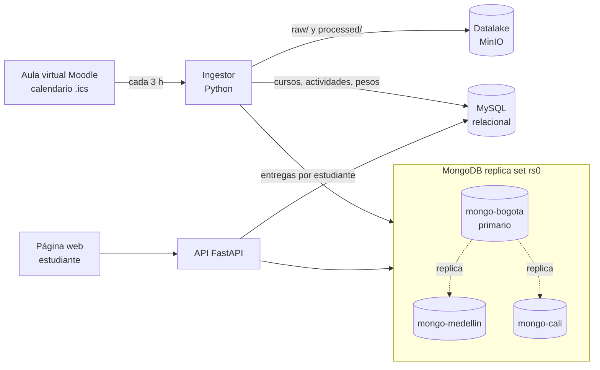
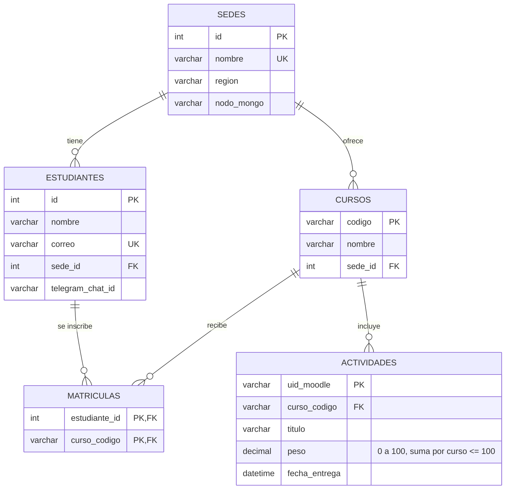

# Diagramas

GitHub dibuja estos diagramas automáticamente.

## Arquitectura



## Modelo entidad-relación (MySQL)



## Documento en MongoDB (colección `entregas`)

```json
{
  "_id": "1:545858@presencial.aulasuniminuto.edu.co",
  "estudiante_id": 1,
  "sede": "Bogotá Calle 80",
  "region": "Bogotá D.C.",
  "curso": "60-83355",
  "uid": "545858@presencial.aulasuniminuto.edu.co",
  "titulo": "60% Entrega proyecta final",
  "peso": 60,
  "fecha_entrega": "2026-11-19T04:00:00Z",
  "estado": "pendiente",
  "origen": "moodle"
}
```
